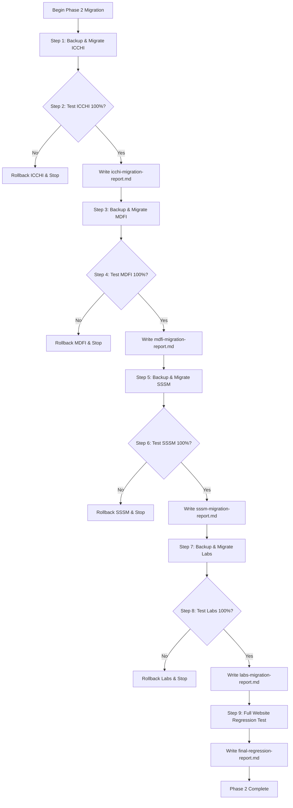

# SIET Phase 2: Standalone Microsite & Portal Organization Plan

**Target Project:** Sri Shakthi Institute of Engineering and Technology (`G:\siet-final\siet-web-final`)  
**Phase:** Phase 2 — Standalone Microsite & Portal Organization  
**Date:** 2026-11-01  
**Status:** **PLANNING & VALIDATION STAGE (Pre-Execution)**

---

## 1. Executive Summary & Core Architectural Boundaries

The primary objective of Phase 2 is to organize the four existing standalone sub-applications and portals into clean, modular, and self-contained directory structures without modifying the main SIET Single-Page Application (SPA) architecture:

1. **ICCHI** — 7th International Conference on Computational and Healthcare Innovations
2. **MDFI** — My Dream India (என் கனவு பாரதம்) State-Level Essay Competition
3. **SSSM** — Sri Shakthi Space Mission & Space Whiz 2026 Online Quiz Contest
4. **Labs** — 7 Specialized Advanced Research Laboratories

### Non-Negotiable Architectural Safeguards
- **Main SIET SPA Invariant:** The main website (`index.html`, `assets/index-Dj3f4kTT.js`, `assets/index-BOwYVr40.css`) remains an intact, compiled Single-Page Application. Zero JavaScript bundles will be decomposed, sliced, or split into static HTML pages.
- **Phase 1 Clean-URL Invariant:** All clean URLs (`/about`, `/admissions`, `/careers`, `/programmes`, `/contact`, `/curriculum`, etc.), legacy hash upgrades, dynamic canonical tags, and backend API endpoints (`/apply-api/`, `/career-api/`) will remain completely functional.
- **Strict One-Portal-at-a-Time Execution:** Portals will be migrated in strict sequential order: ICCHI → MDFI → SSSM → Labs. No portal will be started until the previous portal has passed all automated and interactive verifications.
- **Strict Local Boundary (Git Ban):** Zero `git commit`, `git push`, remote synchronization, or deployment commands will be executed. All changes remain local for review.

---

## 2. Preliminary Inspection Findings & Current State

### A. ICCHI Portal (`icchi/`)
- **Current Layout:**
  - `icchi/index.html` (20,123 B) — Single-page conference portal with countdown timer and mobile drawer.
  - `icchi/icchi.css` (36,370 B) — Custom conference styling.
  - `icchi/icchi.js` (2,757 B) — Countdown timer and mobile nav handler.
  - `icchi/assets/` (5 images: `bme-department-overview.png`, `can-dincer.jpg`, `sabarimalai-manikandan.jpg`, `shang-ming-zhou.jpg`, `sri-shakthi-campus.png`).
- **Dependencies:** Uses fonts from Google Fonts, institution logos from `/brand/`, and cross-site clean URLs to SIET main pages (`/academic-calendar`, `/coe`, `/curriculum`, etc.).
- **Current URL Route:** `/icchi/` (direct directory index).

### B. MDFI Portal (`mdfi/`)
- **Current Layout:**
  - `mdfi/index.html` (35,540 B) — Standalone competition portal with hero section, timeline, guidelines, reward details, and registration link.
  - `mdfi/mdfi.js` (1,508 B) — Page loader and accessible navigation group controller.
  - `mdfi/README.md` (2,491 B) — Overview and contest rules.
- **Dependencies:** Borrows `/assets/index-BOwYVr40.css`, `/assets/space-mission.css`, `/assets/footer-map.css`, plus an inline `<style>` block (~300 lines). Images from `/brand/` (`dream-india-poster.png`, `siet-location-map.png`). Cross-links to SIET clean URLs.
- **Current URL Route:** `/mdfi/` (with redirect from `/mydreamindia` and `/my-dream-india`).

### C. SSSM Portal (`sssm/`)
- **Current Layout:**
  - `sssm/README.md` (1,870 B) — Documentation of Space Mission, SriShakthiSat satellite (ISRO PSLV-C51), and Space Whiz 2026 quiz competition.
  - `sssm/space-whiz-poster.png` (959,769 B) — High-resolution contest poster.
- **Dependencies:** Associated stylesheet exists at `/assets/space-mission.css`. Event cards at `/brand/events/event-space-whiz-hd.webp`. Server redirects routes like `/space-mission`, `/space-whiz`, `/srishakthisat` to `/sssm/`.
- **Current Behavior:** `/sssm/` without an `index.html` was previously falling back to the SPA root.
- **Mandate:** Create an authentic, standalone portal presentation within `sssm/` matching its verified content and poster without inventing fictitious pages or routes.

### D. Labs Portal (`labs.html`)
- **Current Layout:**
  - Root file: `labs.html` (44,580 B) — Comprehensive specialized research laboratories portal.
  - Associated script: `assets/labs.js` (2,786 B) — Lightbox modal, thumbnail switching, and category filtering.
  - Associated stylesheet: `assets/special-labs.css` (24,800 B).
  - Images: 17 laboratory photos in `/assets/images/site/` (`ai.webp`, `cyber1.webp`, `vlsi.webp`, `robo.webp`, etc.).
- **Verified 7 Labs:**
  1. **Artificial Intelligence Lab** (`#ai-lab`)
  2. **Cybersecurity Lab** (`#cyber-cloud-lab`)
  3. **Embedded Systems Lab** (`#embedded-systems-lab`, includes integrated VLSI content)
  4. **AR/VR Lab** (`#ar-vr-lab`)
  5. **Robotics and Automation Lab** (`#robotics-automation-lab`)
  6. **PCB Design and Assembly Lab** (`#pcb-design-assembly-lab`)
  7. **IoT Lab** (`#iot-lab`)
  *(Confirms VLSI is strictly an integrated component of Embedded Systems, NOT an 8th separate lab).*
- **Current URL Route:** `/labs.html` (with redirect from `/labs` and `/special-labs`).

---

## 3. Proposed Target Organization

```text
siet-web-final/
│
├── index.html                   # Unchanged SIET SPA entry shell
├── assets/                       # Unchanged shared bundles, CSS & media
├── brand/                        # Unchanged institutional logos & banners
├── data/                         # SQLite databases & uploads
├── downloads/                    # Official statutory PDFs & forms
├── apply-api/                    # Admission API handlers
├── career-api/                   # Career API handlers
├── local-server.mjs              # Local server routing
├── .htaccess                     # Apache rewrite rules
│
├── icchi/                        # Step 1: ICCHI Conference Microsite
│   ├── index.html                # Main entry point (clean links updated)
│   ├── css/
│   │   └── icchi.css             # Scoped conference styling
│   ├── js/
│   │   └── icchi.js              # Scoped timer & navigation controller
│   ├── assets/                   # Conference speaker portraits & facility imagery
│   │   ├── bme-department-overview.png
│   │   ├── can-dincer.jpg
│   │   ├── sabarimalai-manikandan.jpg
│   │   ├── shang-ming-zhou.jpg
│   │   └── sri-shakthi-campus.png
│   └── documents/                # Conference brochures & call-for-papers PDFs
│
├── mdfi/                         # Step 2: My Dream India Microsite
│   ├── index.html                # Main entry point
│   ├── css/
│   │   └── mdfi.css              # Extracted modular MDFI styles
│   ├── js/
│   │   └── mdfi.js               # Loader & accessible dropdown controller
│   ├── assets/                   # Contest poster & regional map imagery
│   │   ├── dream-india-poster.png
│   │   └── siet-location-map.png
│   ├── documents/                # Topic guidelines & submission templates
│   └── README.md                 # Contest documentation
│
├── sssm/                         # Step 3: Sri Shakthi Space Mission & Space Whiz
│   ├── index.html                # Dedicated standalone space mission portal
│   ├── css/
│   │   └── space-mission.css     # Solar gold & forest green mission styling
│   ├── js/
│   │   └── space-mission.js      # Interactive timeline & quiz registration modal
│   ├── assets/                   # Satellite, ISRO launch & contest posters
│   │   ├── space-whiz-poster.png
│   │   ├── srishakthisat-satellite.webp
│   │   └── isro-launch-pslv.webp
│   ├── documents/                # Space Whiz syllabus & competition rules
│   └── README.md                 # Institutional satellite launch credential
│
├── labs/                         # Step 4: Specialized Research Laboratories
│   ├── index.html                # Consolidated 7-lab showcase with category filters
│   ├── css/
│   │   └── labs.css              # Lightbox, gallery & grid styling
│   ├── js/
│   │   └── labs.js               # Lightbox switcher & interactive filter
│   ├── assets/                   # Lab facility photography & equipment diagrams
│   │   ├── ai/
│   │   ├── cybersecurity/
│   │   ├── embedded-vlsi/
│   │   ├── ar-vr/
│   │   ├── robotics/
│   │   ├── pcb-assembly/
│   │   └── iot/
│   └── pages/                    # Dedicated deep-dive pages for each of the 7 labs
│       ├── artificial-intelligence/index.html
│       ├── cybersecurity/index.html
│       ├── embedded-systems/index.html (with VLSI content)
│       ├── ar-vr/index.html
│       ├── robotics-automation/index.html
│       ├── pcb-design-assembly/index.html
│       └── iot/index.html
│
└── docs/
    ├── portal-organization/      # Migration documentation & reports
    └── content-archive/         # Pre-migration bit-for-bit backups
```

---

## 4. URL Preservation & Server Routing Configuration

### Apache (`.htaccess`)
Ensure the following rewrite order:
1. Direct requests for real files (`-f`) pass through immediately.
2. Direct requests for directories containing `index.html` (`-d`) pass through immediately:
   - `/icchi/` → serves `icchi/index.html`
   - `/mdfi/` → serves `mdfi/index.html`
   - `/sssm/` → serves `sssm/index.html`
   - `/labs/` → serves `labs/index.html`
3. Backwards compatibility:
   - `/labs.html` → 301 Permanent Redirect to `/labs/`
   - `/labs` or `/special-labs` → Rewrites/redirects to `/labs/`
   - Legacy `/sssm` rule updated to serve `/sssm/` directly.
4. Clean SPA fallback (`RewriteRule . /index.html [L]`) continues handling all SIET pages (`/about`, `/careers`, etc.).

### Local Development Server (`local-server.mjs`)
- Directory index handler automatically resolves `/icchi/`, `/mdfi/`, `/sssm/`, `/labs/` to their respective `index.html`.
- Redirect `/labs` and `/special-labs` to `/labs/`.
- Maintain 301/302 compatibility for legacy `/labs.html` requests.
- Strict HTTP 404 for missing static assets (`.js`, `.css`, `.png`, `.webp`, `.pdf`).

---

## 5. Sequential Execution Protocol



---

## 6. Pre-Migration Backup Strategy

Before modifying each portal, a bit-for-bit backup will be written into:
`docs/content-archive/backup-phase2-<portal>/`
File counts, byte sizes, and SHA256 hashes will be recorded in `docs/portal-organization/migration-manifest.md`.
No file will be moved or deleted without a verified backup.

