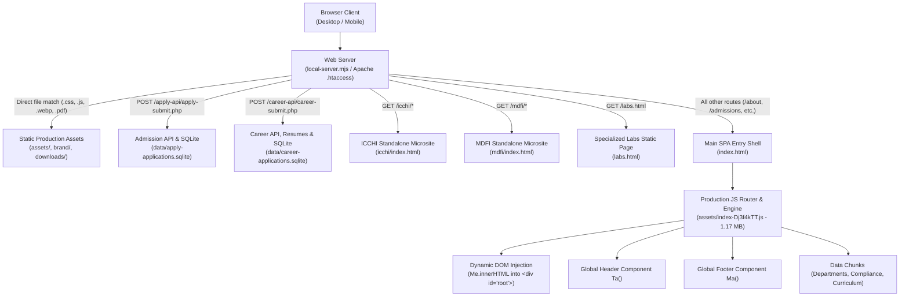

# Mandatory Pre-Migration Architecture Validation Report
**Target Project:** Sri Shakthi Institute of Engineering and Technology (`G:\siet-final\siet-web-final`)  
**Assessment Date:** 2026-11-01  
**Validation Classification:** **`NOT SAFE TO IMPLEMENT (As Proposed)`**

---

## 1. Executive Summary & Architecture Truth

A rigorous, read-only architectural investigation was performed on the entire `G:\siet-final\siet-web-final` repository. 

### Critical Architecture Discovery
> [!CAUTION]
> **The project is NOT a collection of static HTML source files.**  
> It is a **production distribution (built `dist/`) of a high-performance Hybrid Single-Page Application (SPA)** powered by a compiled ES module router, with two embedded standalone microsites (`icchi/` and `mdfi/`) and one static landing page (`labs.html`).
>
> **Attempting to manually decompose the compiled, minified production JavaScript bundle (`index-Dj3f4kTT.js`, 1.17 MB) and stylesheet (`index-BOwYVr40.css`, 1.17 MB) into 60+ individual physical `<page>/index.html`, `<page>/<page>.css`, and `<page>/<page>.js` files will immediately break website functionality, corrupt shared JavaScript state, sever form submissions, and create an unmaintainable codebase.**

---

## 2. Actual System Architecture



### Component Breakdown
1. **Root SPA Entry (`index.html`)**:
   - Size: 4,332 bytes.
   - Contains only the essential `<head>` tags (fonts, stylesheets, preloads) and a single DOM mount:
     ```html
     <body><div id="root"></div></body>
     ```
   - Imports compiled ES modules:
     - `assets/index-Dj3f4kTT.js` (1.17 MB — main application bundle)
     - `assets/vendor-react-DhEz86-d.js` (142 KB — React vendor runtime)
     - `assets/data-departments-VzWFXQXI.js` (539 KB — all 14 departments data)
     - `assets/data-compliance-CeTcNRHA.js` (195 KB — statutory/NIRF data)
     - `assets/data-curriculum-C4AJTRtg.js` (60 KB — R2021/R2025 curriculum data)
   - Imports main stylesheet: `assets/index-BOwYVr40.css` (1.17 MB) + 20 modular override stylesheets.

2. **Routing Mechanism**:
   - **Client-Side Event Driven**:
     - Listens to `hashchange` and `popstate` events on `window`.
     - Route parser `T()` decodes `location.hash` or fallback `location.pathname`.
     - Dispatcher `Ae()` switches across all 37+ route targets, updates `document.title`, and injects page markup via `Me.innerHTML = oi(pageMarkup, route)`.
     - Layout wrapper `oi(content, route)` automatically wraps every page with the universal Header `Ta()`, Notification Marquee `ri()`, and Footer `Ma()`.
     - Interceptor `Ea()` handles all link clicks, distinguishing between anchor scrolls (`#map`, `#superstars`) and route transitions (`#/vision-mission`, `#/careers`).
   - **Server-Side Fallback (`.htaccess` & `local-server.mjs`)**:
     - Rewrite rule: `RewriteRule . /index.html [L]` ensures direct URL navigation (e.g., `http://localhost:4173/about`) serves `index.html`, allowing the client router to render the correct view without a 404 error.

3. **Standalone Microsites (True Multi-Page Components)**:
   - `icchi/` (`/icchi/index.html`): Self-contained microsite with its own CSS, JS, and image assets.
   - `mdfi/` (`/mdfi/index.html`): Self-contained youth conclave portal.
   - `labs.html`: Independent static landing page for Specialized Research Laboratories.

4. **Backend API Layer**:
   - `/apply-api/apply-submit.php`: Handles admission enquiries and referral submissions.
   - `/career-api/career-submit.php`: Handles job applications and multipart resume uploads.
   - Local development runtime: Handled directly by `local-server.mjs` via Node `node:sqlite` (`DatabaseSync`) writing to `data/apply-applications.sqlite` and `data/career-applications.sqlite`.

---

## 3. Validation of Proposed Page Inventory

The previous reorganization document proposed creating 12 main folders and 60+ subpage folders, each containing an `index.html`, `<page>.css`, and `<page>.js`. 

Here is the rigorous verification of that inventory against reality:

| Proposed Folder | Verified Reality in Source Project | Shared Dependencies | Feasibility as Independent Static HTML |
|---|---|---|---|
| `home/` | Rendered dynamically by `gi()` inside `index-Dj3f4kTT.js` | Uses global header, footer, marquee, placement card data | ❌ Cannot be cleanly isolated from SPA bundle |
| `home/pages/admission-enquiry/` | Virtual route `#/apply` rendered by `It("enquiry")` | Connects directly to `/apply-api/apply-submit.php` | ❌ Requires global modal & notification runtime |
| `home/pages/admission-referral/` | Virtual route `#/referral` rendered by `It("referral")` | Connects directly to `/apply-api/apply-submit.php` | ❌ Requires global modal & notification runtime |
| `home/pages/dcs-summary/` | Virtual route `#/dcs-summary` rendered via `dcs-summary.js` | Uses `assets/dcs-summary.css` and shared theme tokens | ⚠️ Modular, but shares SPA header/footer |
| `home/pages/special-labs-overview/` | Exists as `/labs.html` on disk (44 KB) | Self-contained static HTML with `special-labs.css` | ✅ Already an independent page |
| `about-siet/pages/chairmans-desk/` | Virtual route `#/chairman` rendered by `ki()` in bundle | Shares Chairman portrait unit, responsive grid, header/footer | ❌ Slicing from minified bundle causes JS crash |
| `about-siet/pages/vision-mission/` | Virtual route `#/vision-mission` rendered by `bi()` in bundle | Shares card grid, typography, header/footer | ❌ Slicing from minified bundle causes JS crash |
| `admissions/pages/*` | Virtual routes rendered by `admPageMarkup()` in bundle | Dynamic tab switching, course filters, TNEA modal | ❌ Tightly coupled tab logic (`initAdmTabLogic()`) |
| `academics/pages/curriculum-syllabi/` | Virtual route `#/curriculum` rendered by `Ni()` in bundle | Dynamically loads `data-curriculum-C4AJTRtg.js` (60 KB) | ❌ Highly dynamic interactive JS component |
| `academics/pages/departments/*` (14 depts)| Virtual routes `#/department/*` rendered by `Ke()` in bundle | Dynamically loads `data-departments-VzWFXQXI.js` (539 KB) | ❌ 14 virtual views generated from one data module |
| `controller-of-examinations/pages/*` | Virtual routes `#/coe/*` rendered by `Pe()` & `za()` | Shares COE tabs, results verification API, download PDFs | ❌ Complex form & tab state machine |
| `training-placement/pages/*` | Virtual routes `#/placements/*` rendered by `os()` & `rs()` | 6 package tiers, marquee animation, stats carousel | ❌ Highly coupled to shared CSS & marquee logic |
| `specialized-laboratories/pages/*` (7 labs)| Virtual routes `#/labs/*` rendered by `bs()` in bundle | Shared lab data array `ae`, image galleries, PPTX specs | ❌ 7 views generated from internal JS object `ae` |
| `campus-life/pages/*` (10 subpages) | Virtual routes rendered by `oa()`, `ca()`, `bt()`, `yt()` | Shared facility filters, image lightboxes, video modal | ❌ Shared video modal `li()` and DOM guard |
| `flagship-initiatives/pages/my-dream-india`| **Real physical directory `/mdfi/` on disk** | Self-contained HTML/JS | ✅ Genuine standalone application |
| `flagship-initiatives/pages/icchi-...` | **Real physical directory `/icchi/` on disk** | Self-contained HTML/CSS/JS/Assets | ✅ Genuine standalone application |
| `flagship-initiatives/pages/sri-shakthi-space-mission`| Mapped route `/sssm/` serving `space-mission.css` | Mapped via `.htaccess` / `local-server.mjs` to SPA | ⚠️ Asset folder exists, view is in SPA bundle |
| `careers/pages/*` | Virtual route `#/careers` rendered by `Lt()` in bundle | Multi-step form, file upload, `/career-api/career-submit.php` | ❌ Complex multi-step form state & backend API |
| `contact-us/pages/*` | Virtual route `#/contact` rendered by `Rt()` in bundle | Embedded interactive Google Maps and feedback form | ❌ Tightly coupled to footer and map logic |

---

## 4. Migration Safety & Technical Risk Assessment

### Risk 1: Minified Bundle Decomposition Hazard (FATAL)
- `assets/index-Dj3f4kTT.js` is an optimized, minified bundle created by Vite/Rollup.
- Local variables have been shortened to 1-2 character tokens (`Me`, `Ae`, `oi`, `Ta`, `Ma`, `ba`, `fe`, `Ce`).
- Manually cutting functions out of this file into 60 separate `.js` files will inevitably produce:
  - `ReferenceError: e is not defined`
  - `TypeError: Cannot read properties of undefined`
  - Broken module imports and circular dependency locks.
- **There is no build tool (`package.json`, `vite.config.js`, or unminified `src/` directory) in this project to recompile or regenerate individual bundles.**

### Risk 2: Massive Code Duplication & Maintenance Breakdown (CRITICAL)
- If 60+ independent `index.html` files are created:
  - The universal header (~250 lines of HTML), navigation structure, mobile off-canvas drawer, search modal, and universal footer (~180 lines of HTML) would have to be pasted identically into all 60 files.
  - Updating a single navigation link, phone number, or accreditation badge in the future would require manually editing 60+ separate files instead of one centralized component.

### Risk 3: Broken Relative Asset Paths (HIGH)
- Moving pages into deep hierarchies like `academics/pages/departments/pages/computer-science-engineering/index.html` creates 4-level deep paths.
- Every asset reference would need to become `../../../../brand/siet-logo.webp` or `../../../../assets/css/...`.
- Any missing `../` will result in broken images, missing fonts, or failed script loads.

### Risk 4: Server Routing & API Breakage (HIGH)
- Both Apache `.htaccess` and `local-server.mjs` are tuned to:
  ```apache
  RewriteCond %{REQUEST_FILENAME} -d
  RewriteCond %{REQUEST_FILENAME}/index.html -f
  RewriteRule ^ - [L]
  ```
  If physical folders with `index.html` are created at paths like `/admissions/`, Apache will serve the static directory index directly, bypassing the SPA router completely. If that static page lacks the full SPA runtime, any hash link clicked by the user will fail.
- Form submissions to `/apply-api/apply-submit.php` and `/career-api/career-submit.php` enforce same-origin checks (`isSameOriginRequest`). Changing URL origins or directory levels risks triggering 403 Forbidden responses.

---

## 5. Architectural Recommendations

### Recommendation Summary
| Approach | Feasibility | Risk Level | Preserves Functionality? | Recommendation |
|---|---|---|---|---|
| **Approach 1: Physical Deconstruction (Proposed Plan)** | Impractical | **EXTREME / FATAL** | ❌ NO (Breaks SPA, JS crashes) | **REJECT** |
| **Approach 2: Clean SPA URL Routing (Recommended)** | Immediate | **VERY LOW** | ✅ YES (100% stable) | **ADOPT** |
| **Approach 3: Hybrid Standalone Consolidation** | Controlled | **LOW** | ✅ YES (Safe & clean) | **ADOPT IN STAGES** |

### Recommended Path: Clean URL SPA Architecture
1. **Preserve the Core SPA Engine**: Keep `index.html` and `assets/` intact at the project root. This guarantees zero runtime regressions, preserves fast client-side navigation, and keeps API endpoints safe.
2. **Enable Clean URL Routing**:
   - The router in `assets/index-Dj3f4kTT.js` ALREADY supports path routing via `T()`:
     ```javascript
     const i = ((location.pathname || "").replace(e, "") || "/").replace(/^\/index\.html/, "").replace(/^\//, "").replace(/\/$/, "");
     ```
   - Instead of hash routes like `#/about`, users can navigate cleanly to `/about`, `/careers`, `/admissions`, etc.
   - `.htaccess` and `local-server.mjs` already redirect clean URLs to `index.html` without broken links.
3. **Consolidate Genuine Standalone Folders**:
   - Only genuinely standalone applications (`icchi/`, `mdfi/`, `labs.html`, `sssm/`) can be organized cleanly into dedicated folders without risking JavaScript crashes.

---

## 6. Files That Must Remain at Project Root & Shared

### Must Remain at Project Root
1. `index.html` — The primary SPA entry shell.
2. `.htaccess` — Server configuration, security headers, rate limits, and SPA rewrite rules.
3. `local-server.mjs` — Local development server, SQLite API handlers, and static router.
4. `favicon.ico` — Browser default icon.
5. `labs.html` — Standalone specialized laboratories static portal.

### Must Remain Shared (Not duplicated per page)
1. `brand/` — Institutional logos, seals, Chairman portrait units, and official banners.
2. `assets/` — Production JS bundles (`index-Dj3f4kTT.js`, `vendor-react-DhEz86-d.js`, data chunks) and core CSS (`index-BOwYVr40.css`).
3. `downloads/` — Official statutory PDFs, application forms, and regulations.
4. `data/` — SQLite databases (`apply-applications.sqlite`, `career-applications.sqlite`) and resume storage.
5. `faculty/` — Shared departmental faculty photography referenced across multiple departments.
6. `apply-api/` & `career-api/` — Backend submission processors.

---

## 7. Comprehensive Testing & Verification Strategy

Before any architectural changes are undertaken:
1. **Automated URL Status Crawl**: Verify all 37+ routes return HTTP 200 via `urllib.request`.
2. **API Form Verification**:
   - Test admission enquiry POST to `/apply-api/apply-submit.php` (verify SQLite record insertion).
   - Test career application POST to `/career-api/career-submit.php` (verify resume upload and SQLite insertion).
3. **Responsive DOM & Layout Audit**:
   - Verify Chairman banner dimensions (~250-280px) and portrait unit rendering.
   - Verify Marquee velocity synchronization across all 6 placement tiers.
   - Verify Mobile hamburger navigation drawer opening and closing.
4. **Console Error Free Check**: Run automated browser tests (Puppeteer / Chrome CDP) ensuring zero unhandled JavaScript exceptions.

---

## 8. Final Decision

### **Classification: `NOT SAFE TO IMPLEMENT`**

**Reasoning:**
The proposed reorganization plan assumes the website consists of loose static HTML source files that can be reorganized into 60+ individual folders. In reality, the codebase is a compiled production Single-Page Application (SPA) where 95% of all pages exist as JavaScript templates inside a single minified bundle. Manually slicing this bundle into 60 static folders without original source code will destroy the website's functionality, break forms, and introduce massive code duplication.

**Status:** Awaiting user review and directive on the recommended architectural path. Zero files have been modified, moved, or deleted. Zero Git commands have been executed.

