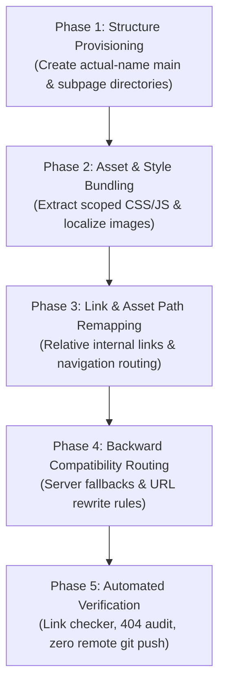

# SIET Website Folder Reorganization Plan
### Architectural Blueprint with Strict Actual-Name Folder Hierarchy

---

## 1. Executive Summary & Core Rules

This document establishes the official folder restructuring plan for the **Sri Shakthi Institute of Engineering and Technology (SIET)** website (`G:\siet-final\siet-web-final`). 

### Strict Naming & Hierarchy Mandates
1. **Zero Generic Placeholders**: No folder may be named `page-one`, `page-two`, `subpage-one`, `subpage-two`, `page-1`, `page-2`, or any arbitrary placeholder.
2. **Actual Page-Derived Folder Names**: Every folder name is derived directly from its verified HTML document title, visible header navigation label, dropdown label, and canonical URL.
3. **Hyphenated Lowercase Format**: Names are formatted in clean, hyphenated lowercase (e.g., `About SIET` → `about-siet/`, `The Chairman's Desk` → `chairmans-desk/`, `Computer Science and Engineering` → `computer-science-engineering/`).
4. **Uniform Hierarchical Standard**: Every main page has its dedicated folder containing its entry point (`index.html`), scoped stylesheet (`<main-page>.css`), scoped script (`<main-page>.js`), localized assets (`assets/`), and its nested subpages housed inside a `pages/` directory.

```text
<actual-main-page-name>/
├── index.html
├── <actual-main-page-name>.css
├── <actual-main-page-name>.js
├── assets/
└── pages/
    ├── <actual-subpage-name>/
    │   ├── index.html
    │   ├── <actual-subpage-name>.css
    │   ├── <actual-subpage-name>.js
    │   └── assets/
    │
    └── <another-actual-subpage-name>/
        ├── index.html
        ├── <another-actual-subpage-name>.css
        ├── <another-actual-subpage-name>.js
        └── assets/
```

5. **Local-Only Boundary**: All modifications remain 100% local. No Git commits, pushes, deployments, or remote publishing operations are permitted.

---

## 2. Complete Real Page & Route Inventory

The following mapping documents every real page, navigation item, active URL hash, and verified title across the SIET portal:

| # | Main Section / Navigation Label | Actual Page Title | Active URL Route | Target Main Folder | Subpage Target Folder |
|---|---|---|---|---|---|
| **01** | **Home** | Sri Shakthi Institute of Engineering & Technology \| Autonomous Institution | `#/` / `/` | `home/` | Root entry |
| 1.1 | Apply Now / Admission Enquiry | Apply for Sri Shakthi \| Admission Enquiry | `#/apply`, `#/admission-enquiry` | `home/` | `pages/admission-enquiry/` |
| 1.2 | Admission Referral | Admission Referral Programme | `#/admission-referral`, `#/referral` | `home/` | `pages/admission-referral/` |
| 1.3 | DCS Summary | DCS Summary — Department Wise Seat Matrix | `#/dcs-summary` | `home/` | `pages/dcs-summary/` |
| 1.4 | Specialized Labs Overview | Specialized Research Laboratories Overview | `#/special-labs`, `/labs.html` | `home/` | `pages/special-labs-overview/` |
| **02** | **About** | About Sri Shakthi Institute of Engineering & Technology | `#/about` | `about-siet/` | Section entry |
| 2.1 | Vision And Mission | Vision, Mission & Quality Policy | `#/vision-mission` | `about-siet/` | `pages/vision-mission/` |
| 2.2 | The Chairman's desk | The Chairman's Desk — Dr. S. Thangavelu | `#/chairman` | `about-siet/` | `pages/chairmans-desk/` |
| 2.3 | From the Principal | From the Principal — Executive Leadership | `#/principal` | `about-siet/` | `pages/principals-desk/` |
| 2.4 | Core Beliefs | Core Beliefs & Enduring Institutional Principles | `#/core-beliefs` | `about-siet/` | `pages/core-beliefs/` |
| 2.5 | Core Values | Core Values & Institutional Ethics | `#/core-values` | `about-siet/` | `pages/core-values/` |
| 2.6 | Program Outcomes | Program Educational Objectives & Outcomes (OBE) | `#/program-outcomes` | `about-siet/` | `pages/program-outcomes/` |
| 2.7 | Institutional Philosophy | Educational Philosophy & Applied Learning | `#/philosophy` | `about-siet/` | `pages/institutional-philosophy/` |
| **03** | **Admission** | Admissions & Management Quota \| Sri Shakthi | `#/admission`, `#/admissions` | `admissions/` | Section entry |
| 3.1 | UG Admissions | Undergraduate Programmes (B.E. / B.Tech) | `#/admission?tab=ug`, `#/undergraduate-programs` | `admissions/` | `pages/undergraduate-programmes/` |
| 3.2 | PG Admissions | Postgraduate Programmes (M.E. / M.Tech) | `#/admission?tab=pg`, `#/postgraduate-programs` | `admissions/` | `pages/postgraduate-programmes/` |
| 3.3 | Ph.D. Programmes | Doctoral Research Admissions (Ph.D.) | `#/admission?tab=phd` | `admissions/` | `pages/phd-research-programmes/` |
| 3.4 | Scholarships | Institutional Scholarships & Merit Financial Aid | `#/admission?tab=scholarships`, `#/scholarships` | `admissions/` | `pages/scholarships-aid/` |
| 3.5 | Campus Walkthrough | Virtual Campus Tour & Immersive Experience | `#/admission?tab=walkthrough` | `admissions/` | `pages/campus-walkthrough/` |
| **04** | **Academics** | Academic Overview \| Anna University Affiliated | `#/academics` | `academics/` | Section entry |
| 4.1 | UG, PG & Ph.D Programmes | Degree Programmes Directory | `#/programmes` | `academics/` | `pages/degree-programmes/` |
| 4.2 | Curriculum | Autonomous Curriculum & Regulations (R2021 & R2025) | `#/curriculum` | `academics/` | `pages/curriculum-syllabi/` |
| 4.3 | Academic Calendar | Academic Schedule & Assessment Calendar | `#/academic-calendar` | `academics/` | `pages/academic-calendar/` |
| 4.4 | Library | Dr. A.P.J. Abdul Kalam Central Library | `#/library` | `academics/` | `pages/central-library/` |
| 4.5 | Departments Hub | Academic Departments Directory | `#/departments` | `academics/` | `pages/departments/` |
| 4.5.1 | Agri Dept | Department of Agricultural Engineering | `#/department/agri` | `academics/` | `pages/departments/pages/agricultural-engineering/` |
| 4.5.2 | AI & DS Dept | Department of Artificial Intelligence & Data Science | `#/department/aids` | `academics/` | `pages/departments/pages/artificial-intelligence-data-science/` |
| 4.5.3 | AI & ML Dept | Department of Artificial Intelligence & Machine Learning | `#/department/aiml` | `academics/` | `pages/departments/pages/artificial-intelligence-machine-learning/` |
| 4.5.4 | BME Dept | Department of Biomedical Engineering | `#/department/bme` | `academics/` | `pages/departments/pages/biomedical-engineering/` |
| 4.5.5 | Biotech Dept | Department of Biotechnology | `#/department/biotech` | `academics/` | `pages/departments/pages/biotechnology/` |
| 4.5.6 | Civil Dept | Department of Civil Engineering | `#/department/civil` | `academics/` | `pages/departments/pages/civil-engineering/` |
| 4.5.7 | CSE Dept | Department of Computer Science & Engineering | `#/department/cse` | `academics/` | `pages/departments/pages/computer-science-engineering/` |
| 4.5.8 | Cyber Security Dept | Department of Computer Science & Engg (Cyber Security) | `#/department/cyber` | `academics/` | `pages/departments/pages/computer-science-engineering-cyber-security/` |
| 4.5.9 | EEE Dept | Department of Electrical & Electronics Engineering | `#/department/eee` | `academics/` | `pages/departments/pages/electrical-electronics-engineering/` |
| 4.5.10| ECE Dept | Department of Electronics & Communication Engineering | `#/department/ece` | `academics/` | `pages/departments/pages/electronics-communication-engineering/` |
| 4.5.11| Food Tech Dept | Department of Food Technology | `#/department/food-tech` | `academics/` | `pages/departments/pages/food-technology/` |
| 4.5.12| IT Dept | Department of Information Technology | `#/department/it` | `academics/` | `pages/departments/pages/information-technology/` |
| 4.5.13| Mech Dept | Department of Mechanical Engineering | `#/department/mech` | `academics/` | `pages/departments/pages/mechanical-engineering/` |
| 4.5.14| VLSI Dept | Department of Electronics Engineering (VLSI Design) | `#/department/ece-vlsi` | `academics/` | `pages/departments/pages/electronics-engineering-vlsi-design/` |
| 4.5.15| S&H Dept | Department of Science and Humanities | `#/department/science-humanities` | `academics/` | `pages/departments/pages/science-humanities/` |
| **05** | **Accreditation** | Approvals & Accreditations \| Institutional Excellence | `#/accreditation`, `#/accreditations` | `accreditation-rankings/` | Section entry |
| 5.1 | NAAC | NAAC Grade ‘A’ Institutional Accreditation & SSR | `#/naac` | `accreditation-rankings/` | `pages/naac-accreditation/` |
| 5.2 | NBA | NBA Tier-I Washington Accord Programmes | `#/nba` | `accreditation-rankings/` | `pages/nba-accreditation/` |
| 5.3 | NIRF | National Institutional Ranking Framework (NIRF) | `#/nirf` | `accreditation-rankings/` | `pages/nirf-ranking/` |
| 5.4 | IQAC | Internal Quality Assurance Cell (IQAC) | `#/iqac` | `accreditation-rankings/` | `pages/iqac-cell/` |
| 5.5 | ARIIA Report | Atal Ranking on Innovation Achievements (ARIIA) | `#/ariia`, `#/ariia-report` | `accreditation-rankings/` | `pages/ariia-report/` |
| 5.6 | Governance / Committees | Governance & Statutory Committees | `#/governance`, `#/committees` | `accreditation-rankings/` | `pages/governance-committees/` |
| 5.7 | Mandatory Disclosure | AICTE Mandatory Disclosure | `#/mandatory-disclosure` | `accreditation-rankings/` | `pages/mandatory-disclosure/` |
| 5.8 | Statutory Declaration | Statutory Declaration Under RTI Act 2005 | `#/statutory-declaration`, `#/rti` | `accreditation-rankings/` | `pages/statutory-declaration-rti/` |
| **06** | **COE** | Office of the Controller of Examinations | `#/coe` | `controller-of-examinations/`| Section entry |
| 6.1 | Regulations | Autonomous Examination Regulations | `#/coe-regulations`, `#/regulations` | `controller-of-examinations/`| `pages/examination-regulations/` |
| 6.2 | Results Portal | Autonomous Semester Examination Results Portal | `#/coe-result`, `#/result` | `controller-of-examinations/`| `pages/examination-results/` |
| 6.3 | Forms & Downloads | COE Downloads & Revaluation/Photocopy Forms | `#/coe-downloads`, `#/downloads` | `controller-of-examinations/`| `pages/downloads-forms/` |
| 6.4 | Transcripts | Official Transcripts & Degree Verification | `#/coe-transcript`, `#/transcript` | `controller-of-examinations/`| `pages/transcripts-verification/` |
| **07** | **Placements** | Training & Placement Cell \| Career Readiness | `#/placements` | `training-placement/` | Section entry |
| 7.1 | Superstars Showcase | Placement Superstars & Package Tiers | `#/placements#superstars` | `training-placement/` | `pages/placement-superstars/` |
| 7.2 | Career Development | Career Development & Technical Skill Training | `#/training`, `#/career-development` | `training-placement/` | `pages/career-development-training/` |
| 7.3 | Higher Education | Higher Education & Global University Admissions | `#/placements/higher-education` | `training-placement/` | `pages/higher-education-cell/` |
| 7.4 | Civil Services | Sri Shakthi Civil Services & Public Sector Coaching | `#/placements/government-services` | `training-placement/` | `pages/civil-services-academy/` |
| 7.5 | Entrepreneurship | Entrepreneurship Development Cell (EDC / E-Cell) | `#/entrepreneurship` | `training-placement/` | `pages/entrepreneurship-development-cell/` |
| **08** | **Centres of Excellence** | Centres of Excellence & Specialized Laboratories | `#/centres-of-excellence`, `#/labs` | `specialized-laboratories/` | Section entry |
| 8.1 | AI Lab | Artificial Intelligence Research Lab (Intel AI) | `#/labs/ai-lab` | `specialized-laboratories/` | `pages/artificial-intelligence-lab/` |
| 8.2 | Cybersecurity Lab | Cybersecurity & Cloud Defense Research Lab | `#/labs/cyber-cloud-lab` | `specialized-laboratories/` | `pages/cybersecurity-research-lab/` |
| 8.3 | Embedded Systems Lab | Embedded Systems & VLSI Research Lab | `#/labs/embedded-systems-lab` | `specialized-laboratories/` | `pages/embedded-systems-vlsi-lab/` |
| 8.4 | AR & VR Lab | Augmented & Virtual Reality Research Lab | `#/labs/ar-vr-lab` | `specialized-laboratories/` | `pages/augmented-virtual-reality-lab/` |
| 8.5 | Robotics & Automation | Robotics & Industrial Automation Lab | `#/labs/robotics-automation-lab` | `specialized-laboratories/` | `pages/robotics-automation-lab/` |
| 8.6 | PCB Design & Assembly | PCB Design & Surface Mount Assembly Lab | `#/labs/pcb-design-assembly-lab` | `specialized-laboratories/` | `pages/pcb-design-assembly-lab/` |
| 8.7 | IoT Lab | Internet of Things & Smart Telemetry Lab | `#/labs/iot-lab` | `specialized-laboratories/` | `pages/internet-of-things-lab/` |
| **09** | **Campus Life** | Student Life & Campus Community \| Sri Shakthi | `#/campus-life`, `#/student-life` | `campus-life/` | Section entry |
| 9.1 | Student Life | Student Life & Campus Community | `#/student-life` | `campus-life/` | `pages/student-life/` |
| 9.2 | Sports & Recreation | Sports Facilities & Athletic Championships | `#/sports-recreation` | `campus-life/` | `pages/sports-recreation/` |
| 9.3 | Innovation & Incubation | Innovation Ecosystem & Technology Business Incubator | `#/innovation` | `campus-life/` | `pages/innovation-incubation/` |
| 9.4 | Culture & Arts | Cultural Events, Music & Fine Arts | `#/culture-arts` | `campus-life/` | `pages/culture-arts/` |
| 9.5 | Learning & Growth | Academic Mentorship & Personal Growth | `#/learning-growth` | `campus-life/` | `pages/learning-growth/` |
| 9.6 | Campus Facilities | Campus Infrastructure & Eco-Friendly Grounds | `#/our-campus` | `campus-life/` | `pages/campus-facilities/` |
| 9.7 | Hostels | Residential Hostels & Student Dining | `#/hostel` | `campus-life/` | `pages/student-hostels/` |
| 9.8 | Transport | Bus Fleet Routes & Stop Locator | `#/transport` | `campus-life/` | `pages/transport-fleet/` |
| 9.9 | Student Clubs | Technical, Cultural & Social Student Clubs | `#/clubs` | `campus-life/` | `pages/student-clubs/` |
| 9.10| Alumni Network | Shakthians Global Alumni Network | `#/alumni`, `#/alumni-network` | `campus-life/` | `pages/alumni-network/` |
| **10** | **Flagship Initiatives** | Flagship Institutional Projects & Conclaves | `/sssm`, `/mdfi`, `/icchi` | `flagship-initiatives/` | Section entry |
| 10.1| Space Mission | Sri Shakthi Space Mission (SriShakthiSat) | `/sssm/`, `#/sssm` | `flagship-initiatives/` | `pages/sri-shakthi-space-mission/` |
| 10.2| My Dream India | My Dream India (MDFI) Youth Conclave | `/mdfi/`, `#/mdfi` | `flagship-initiatives/` | `pages/my-dream-india/` |
| 10.3| ICCHI 2027 Conference | 7th Int. Conf. on Computational & Healthcare Innovations | `/icchi/`, `#/icchi` | `flagship-initiatives/` | `pages/icchi-international-conference/` |
| **11** | **Careers** | Careers & Faculty Opportunities \| Sri Shakthi | `#/careers` | `careers/` | Section entry |
| 11.1| Faculty Openings | Teaching & Professorial Positions | `#/careers?institution=college` | `careers/` | `pages/faculty-positions/` |
| 11.2| Non-Teaching Staff | Administrative, Technical & Support Staff | `#/careers?tab=staff` | `careers/` | `pages/non-teaching-staff/` |
| 11.3| Application Portal | Online Job Requisition & Resume Submission | `#/careers#apply` | `careers/` | `pages/application-portal/` |
| **12** | **Contact Us** | Contact Sri Shakthi Institute of Engineering & Technology| `#/contact` | `contact-us/` | Section entry |
| 12.1| Campus Location Map | Campus Location, Route Maps & Transport Access | `#/contact#map` | `contact-us/` | `pages/campus-location-map/` |
| 12.2| Department Directory | Department HODs & Administrative Contacts Directory | `#/contact#directory` | `contact-us/` | `pages/department-directory/` |

---

## 3. Physical Directory Tree Specification

The structural representation below demonstrates the strict folder structure. Notice that **every single folder** has an actual, self-documenting name:

```text
G:\siet-final\siet-web-final\
├── index.html                                        <- Root redirect / shell loader
├── brand/                                            <- Shared global identity marks (logos, crests, portraits)
├── shared/                                           <- Universal UI components, global fonts, design tokens
│   ├── css/
│   │   ├── tokens.css
│   │   ├── base.css
│   │   └── typography.css
│   └── js/
│       ├── router.js
│       └── dom-guard.js
│
├── home/
│   ├── index.html
│   ├── home.css
│   ├── home.js
│   ├── assets/
│   └── pages/
│       ├── admission-enquiry/
│       │   ├── index.html
│       │   ├── admission-enquiry.css
│       │   ├── admission-enquiry.js
│       │   └── assets/
│       ├── admission-referral/
│       │   ├── index.html
│       │   ├── admission-referral.css
│       │   ├── admission-referral.js
│       │   └── assets/
│       ├── dcs-summary/
│       │   ├── index.html
│       │   ├── dcs-summary.css
│       │   ├── dcs-summary.js
│       │   └── assets/
│       └── special-labs-overview/
│           ├── index.html
│           ├── special-labs-overview.css
│           ├── special-labs-overview.js
│           └── assets/
│
├── about-siet/
│   ├── index.html
│   ├── about-siet.css
│   ├── about-siet.js
│   ├── assets/
│   └── pages/
│       ├── vision-mission/
│       │   ├── index.html
│       │   ├── vision-mission.css
│       │   ├── vision-mission.js
│       │   └── assets/
│       ├── chairmans-desk/
│       │   ├── index.html
│       │   ├── chairmans-desk.css
│       │   ├── chairmans-desk.js
│       │   └── assets/
│       ├── principals-desk/
│       │   ├── index.html
│       │   ├── principals-desk.css
│       │   ├── principals-desk.js
│       │   └── assets/
│       ├── core-beliefs/
│       │   ├── index.html
│       │   ├── core-beliefs.css
│       │   ├── core-beliefs.js
│       │   └── assets/
│       ├── core-values/
│       │   ├── index.html
│       │   ├── core-values.css
│       │   ├── core-values.js
│       │   └── assets/
│       ├── program-outcomes/
│       │   ├── index.html
│       │   ├── program-outcomes.css
│       │   ├── program-outcomes.js
│       │   └── assets/
│       └── institutional-philosophy/
│           ├── index.html
│           ├── institutional-philosophy.css
│           ├── institutional-philosophy.js
│           └── assets/
│
├── admissions/
│   ├── index.html
│   ├── admissions.css
│   ├── admissions.js
│   ├── assets/
│   └── pages/
│       ├── undergraduate-programmes/
│       │   ├── index.html
│       │   ├── undergraduate-programmes.css
│       │   ├── undergraduate-programmes.js
│       │   └── assets/
│       ├── postgraduate-programmes/
│       │   ├── index.html
│       │   ├── postgraduate-programmes.css
│       │   ├── postgraduate-programmes.js
│       │   └── assets/
│       ├── phd-research-programmes/
│       │   ├── index.html
│       │   ├── phd-research-programmes.css
│       │   ├── phd-research-programmes.js
│       │   └── assets/
│       ├── scholarships-aid/
│       │   ├── index.html
│       │   ├── scholarships-aid.css
│       │   ├── scholarships-aid.js
│       │   └── assets/
│       └── campus-walkthrough/
│           ├── index.html
│           ├── campus-walkthrough.css
│           ├── campus-walkthrough.js
│           └── assets/
│
├── academics/
│   ├── index.html
│   ├── academics.css
│   ├── academics.js
│   ├── assets/
│   └── pages/
│       ├── degree-programmes/
│       │   ├── index.html
│       │   ├── degree-programmes.css
│       │   ├── degree-programmes.js
│       │   └── assets/
│       ├── curriculum-syllabi/
│       │   ├── index.html
│       │   ├── curriculum-syllabi.css
│       │   ├── curriculum-syllabi.js
│       │   └── assets/
│       ├── academic-calendar/
│       │   ├── index.html
│       │   ├── academic-calendar.css
│       │   ├── academic-calendar.js
│       │   └── assets/
│       ├── central-library/
│       │   ├── index.html
│       │   ├── central-library.css
│       │   ├── central-library.js
│       │   └── assets/
│       └── departments/
│           ├── index.html
│           ├── departments.css
│           ├── departments.js
│           ├── assets/
│           └── pages/
│               ├── agricultural-engineering/
│               │   ├── index.html
│               │   ├── agricultural-engineering.css
│               │   ├── agricultural-engineering.js
│               │   └── assets/
│               ├── artificial-intelligence-data-science/
│               │   ├── index.html
│               │   ├── artificial-intelligence-data-science.css
│               │   ├── artificial-intelligence-data-science.js
│               │   └── assets/
│               ├── artificial-intelligence-machine-learning/
│               │   ├── index.html
│               │   ├── artificial-intelligence-machine-learning.css
│               │   ├── artificial-intelligence-machine-learning.js
│               │   └── assets/
│               ├── biomedical-engineering/
│               │   ├── index.html
│               │   ├── biomedical-engineering.css
│               │   ├── biomedical-engineering.js
│               │   └── assets/
│               ├── biotechnology/
│               │   ├── index.html
│               │   ├── biotechnology.css
│               │   ├── biotechnology.js
│               │   └── assets/
│               ├── civil-engineering/
│               │   ├── index.html
│               │   ├── civil-engineering.css
│               │   ├── civil-engineering.js
│               │   └── assets/
│               ├── computer-science-engineering/
│               │   ├── index.html
│               │   ├── computer-science-engineering.css
│               │   ├── computer-science-engineering.js
│               │   └── assets/
│               ├── computer-science-engineering-cyber-security/
│               │   ├── index.html
│               │   ├── computer-science-engineering-cyber-security.css
│               │   ├── computer-science-engineering-cyber-security.js
│               │   └── assets/
│               ├── electrical-electronics-engineering/
│               │   ├── index.html
│               │   ├── electrical-electronics-engineering.css
│               │   ├── electrical-electronics-engineering.js
│               │   └── assets/
│               ├── electronics-communication-engineering/
│               │   ├── index.html
│               │   ├── electronics-communication-engineering.css
│               │   ├── electronics-communication-engineering.js
│               │   └── assets/
│               ├── food-technology/
│               │   ├── index.html
│               │   ├── food-technology.css
│               │   ├── food-technology.js
│               │   └── assets/
│               ├── information-technology/
│               │   ├── index.html
│               │   ├── information-technology.css
│               │   ├── information-technology.js
│               │   └── assets/
│               ├── mechanical-engineering/
│               │   ├── index.html
│               │   ├── mechanical-engineering.css
│               │   ├── mechanical-engineering.js
│               │   └── assets/
│               ├── electronics-engineering-vlsi-design/
│               │   ├── index.html
│               │   ├── electronics-engineering-vlsi-design.css
│               │   ├── electronics-engineering-vlsi-design.js
│               │   └── assets/
│               └── science-humanities/
│                   ├── index.html
│                   ├── science-humanities.css
│                   ├── science-humanities.js
│                   └── assets/
│
├── accreditation-rankings/
│   ├── index.html
│   ├── accreditation-rankings.css
│   ├── accreditation-rankings.js
│   ├── assets/
│   └── pages/
│       ├── naac-accreditation/
│       │   ├── index.html
│       │   ├── naac-accreditation.css
│       │   ├── naac-accreditation.js
│       │   └── assets/
│       ├── nba-accreditation/
│       │   ├── index.html
│       │   ├── nba-accreditation.css
│       │   ├── nba-accreditation.js
│       │   └── assets/
│       ├── nirf-ranking/
│       │   ├── index.html
│       │   ├── nirf-ranking.css
│       │   ├── nirf-ranking.js
│       │   └── assets/
│       ├── iqac-cell/
│       │   ├── index.html
│       │   ├── iqac-cell.css
│       │   ├── iqac-cell.js
│       │   └── assets/
│       ├── ariia-report/
│       │   ├── index.html
│       │   ├── ariia-report.css
│       │   ├── ariia-report.js
│       │   └── assets/
│       ├── governance-committees/
│       │   ├── index.html
│       │   ├── governance-committees.css
│       │   ├── governance-committees.js
│       │   └── assets/
│       ├── mandatory-disclosure/
│       │   ├── index.html
│       │   ├── mandatory-disclosure.css
│       │   ├── mandatory-disclosure.js
│       │   └── assets/
│       └── statutory-declaration-rti/
│           ├── index.html
│           ├── statutory-declaration-rti.css
│           ├── statutory-declaration-rti.js
│           └── assets/
│
├── controller-of-examinations/
│   ├── index.html
│   ├── controller-of-examinations.css
│   ├── controller-of-examinations.js
│   ├── assets/
│   └── pages/
│       ├── examination-regulations/
│       │   ├── index.html
│       │   ├── examination-regulations.css
│       │   ├── examination-regulations.js
│       │   └── assets/
│       ├── examination-results/
│       │   ├── index.html
│       │   ├── examination-results.css
│       │   ├── examination-results.js
│       │   └── assets/
│       ├── downloads-forms/
│       │   ├── index.html
│       │   ├── downloads-forms.css
│       │   ├── downloads-forms.js
│       │   └── assets/
│       └── transcripts-verification/
│           ├── index.html
│           ├── transcripts-verification.css
│           ├── transcripts-verification.js
│           └── assets/
│
├── training-placement/
│   ├── index.html
│   ├── training-placement.css
│   ├── training-placement.js
│   ├── assets/
│   └── pages/
│       ├── placement-superstars/
│       │   ├── index.html
│       │   ├── placement-superstars.css
│       │   ├── placement-superstars.js
│       │   └── assets/
│       ├── career-development-training/
│       │   ├── index.html
│       │   ├── career-development-training.css
│       │   ├── career-development-training.js
│       │   └── assets/
│       ├── higher-education-cell/
│       │   ├── index.html
│       │   ├── higher-education-cell.css
│       │   ├── higher-education-cell.js
│       │   └── assets/
│       ├── civil-services-academy/
│       │   ├── index.html
│       │   ├── civil-services-academy.css
│       │   ├── civil-services-academy.js
│       │   └── assets/
│       └── entrepreneurship-development-cell/
│           ├── index.html
│           ├── entrepreneurship-development-cell.css
│           ├── entrepreneurship-development-cell.js
│           └── assets/
│
├── specialized-laboratories/
│   ├── index.html
│   ├── specialized-laboratories.css
│   ├── specialized-laboratories.js
│   ├── assets/
│   └── pages/
│       ├── artificial-intelligence-lab/
│       │   ├── index.html
│       │   ├── artificial-intelligence-lab.css
│       │   ├── artificial-intelligence-lab.js
│       │   └── assets/
│       ├── cybersecurity-research-lab/
│       │   ├── index.html
│       │   ├── cybersecurity-research-lab.css
│       │   ├── cybersecurity-research-lab.js
│       │   └── assets/
│       ├── embedded-systems-vlsi-lab/
│       │   ├── index.html
│       │   ├── embedded-systems-vlsi-lab.css
│       │   ├── embedded-systems-vlsi-lab.js
│       │   └── assets/
│       ├── augmented-virtual-reality-lab/
│       │   ├── index.html
│       │   ├── augmented-virtual-reality-lab.css
│       │   ├── augmented-virtual-reality-lab.js
│       │   └── assets/
│       ├── robotics-automation-lab/
│       │   ├── index.html
│       │   ├── robotics-automation-lab.css
│       │   ├── robotics-automation-lab.js
│       │   └── assets/
│       ├── pcb-design-assembly-lab/
│       │   ├── index.html
│       │   ├── pcb-design-assembly-lab.css
│       │   ├── pcb-design-assembly-lab.js
│       │   └── assets/
│       └── internet-of-things-lab/
│           ├── index.html
│           ├── internet-of-things-lab.css
│           ├── internet-of-things-lab.js
│           └── assets/
│
├── campus-life/
│   ├── index.html
│   ├── campus-life.css
│   ├── campus-life.js
│   ├── assets/
│   └── pages/
│       ├── student-life/
│       │   ├── index.html
│       │   ├── student-life.css
│       │   ├── student-life.js
│       │   └── assets/
│       ├── sports-recreation/
│       │   ├── index.html
│       │   ├── sports-recreation.css
│       │   ├── sports-recreation.js
│       │   └── assets/
│       ├── innovation-incubation/
│       │   ├── index.html
│       │   ├── innovation-incubation.css
│       │   ├── innovation-incubation.js
│       │   └── assets/
│       ├── culture-arts/
│       │   ├── index.html
│       │   ├── culture-arts.css
│       │   ├── culture-arts.js
│       │   └── assets/
│       ├── learning-growth/
│       │   ├── index.html
│       │   ├── learning-growth.css
│       │   ├── learning-growth.js
│       │   └── assets/
│       ├── campus-facilities/
│       │   ├── index.html
│       │   ├── campus-facilities.css
│       │   ├── campus-facilities.js
│       │   └── assets/
│       ├── student-hostels/
│       │   ├── index.html
│       │   ├── student-hostels.css
│       │   ├── student-hostels.js
│       │   └── assets/
│       ├── transport-fleet/
│       │   ├── index.html
│       │   ├── transport-fleet.css
│       │   ├── transport-fleet.js
│       │   └── assets/
│       ├── student-clubs/
│       │   ├── index.html
│       │   ├── student-clubs.css
│       │   ├── student-clubs.js
│       │   └── assets/
│       └── alumni-network/
│           ├── index.html
│           ├── alumni-network.css
│           ├── alumni-network.js
│           └── assets/
│
├── flagship-initiatives/
│   ├── index.html
│   ├── flagship-initiatives.css
│   ├── flagship-initiatives.js
│   ├── assets/
│   └── pages/
│       ├── sri-shakthi-space-mission/
│       │   ├── index.html
│       │   ├── sri-shakthi-space-mission.css
│       │   ├── sri-shakthi-space-mission.js
│       │   └── assets/
│       ├── my-dream-india/
│       │   ├── index.html
│       │   ├── my-dream-india.css
│       │   ├── my-dream-india.js
│       │   └── assets/
│       └── icchi-international-conference/
│           ├── index.html
│           ├── icchi-international-conference.css
│           ├── icchi-international-conference.js
│           └── assets/
│
├── careers/
│   ├── index.html
│   ├── careers.css
│   ├── careers.js
│   ├── assets/
│   └── pages/
│       ├── faculty-positions/
│       │   ├── index.html
│       │   ├── faculty-positions.css
│       │   ├── faculty-positions.js
│       │   └── assets/
│       ├── non-teaching-staff/
│       │   ├── index.html
│       │   ├── non-teaching-staff.css
│       │   ├── non-teaching-staff.js
│       │   └── assets/
│       └── application-portal/
│           ├── index.html
│           ├── application-portal.css
│           ├── application-portal.js
│           └── assets/
│
├── contact-us/
│   ├── index.html
│   ├── contact-us.css
│   ├── contact-us.js
│   ├── assets/
│   └── pages/
│       ├── campus-location-map/
│       │   ├── index.html
│       │   ├── campus-location-map.css
│       │   ├── campus-location-map.js
│       │   └── assets/
│       └── department-directory/
│           ├── index.html
│           ├── department-directory.css
│           ├── department-directory.js
│           └── assets/
│
├── downloads/                                        <- Public regulatory downloads (regulations, forms, NBA reports)
├── data/                                             <- SQLite databases & backend application stores
│   ├── apply-applications.sqlite
│   ├── career-applications.sqlite
│   └── career-resumes/
│
├── apply-api/                                        <- Express/Node.js API for admissions enquiries
└── career-api/                                       <- Express/Node.js API for career applications
```

---

## 4. Migration Execution Phases

To execute this migration without downtime or broken links, work proceeds in five coordinated phases:



### Phase 1: Structure Provisioning
- Create all 12 main folders and their respective `pages/<actual-subpage-name>/` folders as specified in Section 3.
- Establish `assets/` subdirectories inside each page folder for dedicated media and graphic assets.
- Create root `shared/` for truly universal assets (e.g. `siet-logo.webp`, design system tokens).

### Phase 2: Modular Asset & Code Extraction
- Extract monolithic stylesheet segments from `assets/index-BOwYVr40.css` into page-scoped files:
  - Header, footer, and navigation → `shared/css/base.css`
  - Homepage hero, admissions banner, and placement carousel → `home/home.css`
  - Chairman vision section & portrait unit → `about-siet/pages/chairmans-desk/chairmans-desk.css`
  - Lab equipment cards & stats → `specialized-laboratories/specialized-laboratories.css`
- Move existing standalone folders (`icchi/`, `mdfi/`, `sssm/`) into their dedicated positions under `flagship-initiatives/pages/`.
- Localize images from `assets/images/site/*` directly into the corresponding page `assets/` folder.

### Phase 3: Path & Reference Remapping
- Convert all internal absolute asset references (e.g., `/assets/images/site/ai.webp`) to clean relative references (e.g., `../assets/ai.webp` or `/specialized-laboratories/pages/artificial-intelligence-lab/assets/ai.webp`).
- Ensure all navigation items in header dropdowns point cleanly to the new folder endpoints (e.g., `href="/about-siet/pages/chairmans-desk/"` or preserved hash routes).

### Phase 4: Backward-Compatible Routing & Server Configuration
- Configure `.htaccess` and `local-server.mjs` rewrite rules to ensure all legacy bookmarks and external Google links continue to resolve seamlessly:
  - `#/chairman` → `/about-siet/pages/chairmans-desk/`
  - `#/programmes` → `/academics/pages/degree-programmes/`
  - `#/labs/ai-lab` → `/specialized-laboratories/pages/artificial-intelligence-lab/`
  - `/labs.html` → `/home/pages/special-labs-overview/`
  - `/mdfi/` → `/flagship-initiatives/pages/my-dream-india/`
  - `/sssm/` → `/flagship-initiatives/pages/sri-shakthi-space-mission/`
  - `/icchi/` → `/flagship-initiatives/pages/icchi-international-conference/`
- Ensure HTTP 301 redirects are in place for canonical resolution.

### Phase 5: Verification & Zero-Push Enforcement
- Execute a comprehensive local HTTP crawl across all 80+ endpoints using a custom Python link crawler.
- Verify that every image loads with HTTP 200 and correct dimensions.
- Confirm that existing responsive design, mobile hamburger drawer, and fast marquee calibrations remain untouched.
- **Strictly enforce**: No `git commit`, `git push`, or remote publish commands. All code changes stay strictly on the local drive.

